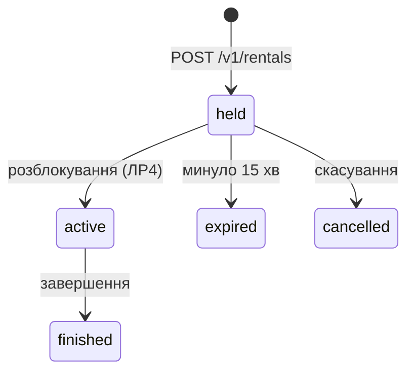
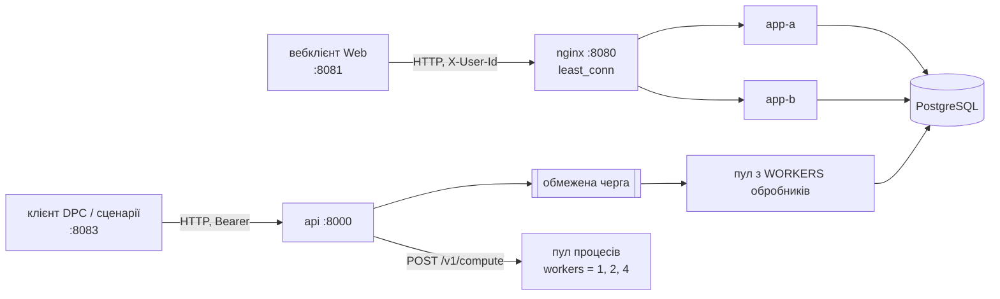
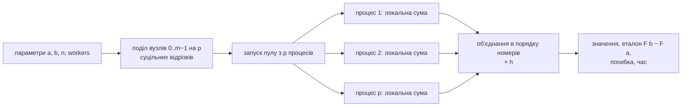

# C08. Каршеринг – спільний проєкт курсів «Обмін даними у Web-застосунках» і «Розподілені та паралельні обчислення»

Опис реалізованого проєкту та його результатів за шаблонами `README-template.md` обох курсів.
Частина Web обслуговує водіїв, частина DPC веде облік оренд зон; спільні PostgreSQL і предметна модель.

## 1. Курс і тема

| | |
|---|---|
| Курси | «Обмін даними у Web-застосунках» (Web) · «Розподілені та паралельні обчислення» (DPC) |
| Тема | C08. Каршеринг |
| Автори | Володимир Нагорнюк, Владислав Даценко |
| Стан | виконано ЛР1 і ЛР2 обох курсів |

## 2. Проєкт

Водій бронює автомобіль на 15 хвилин, розблоковує його після перевірки посвідчення, їде й завершує
оренду. Головна складність – двоє на один автомобіль біля аеропорту.

**Ролі.** Водій (`user`) бронює й бачить лише свої оренди; оператор (`staff`) переводить авто на обслуговування.

**Головна операція.** Web – `POST /v1/rentals`, бронювання автомобіля (стан `held`). DPC – `POST /v1/rental-starts`,
команда «старт оренди» в обмежену чергу.

**Стани й переходи.** Оренда (Web): `held → active → finished`; `held → expired | cancelled`.
Команда старту (DPC): `queued → processing → done | rejected | failed`.



**Ресурс та інваріанти.**

| # | Інваріант | Частина | Як забезпечено |
|---|---|---|---|
| 1 | Автомобіль не більше ніж в одній незавершеній оренді (`held` або `active`) | Web | `SELECT … FOR UPDATE` рядка `car` у транзакції бронювання + частковий унікальний індекс `rental_one_open_per_car` |
| 2 | Автомобіль на обслуговуванні не бронюється | Web | перевірка `car.status` під тим самим блокуванням |
| 3 | Орендованих авто зони не більше, ніж є (`zone_cars`): `rented` = кількість ефектів ≤ `cars_total` | DPC | `SELECT … FOR UPDATE` рядка `zone_cars`; перевірка, зміна й запис ефекту – одна транзакція |
| 4 | Повтор бронювання з тим самим `Idempotency-Key` не створює другої оренди | Web | ключ, відбиток тіла й відповідь записуються в тій самій транзакції, що й оренда (ЛР2) |

**Повільний виклик (DPC).** Перевірка посвідчення водія, 300–900 мс; посвідчення водіїв з id на `nolicense` не
підтверджується (навчальне правило).

**Точні величини й час.** Тариф – копійки за хвилину й за кілометр (`integer`), суми – `bigint` копійок + валюта `UAH`.
Моменти – `timestamptz`, у клієнті показуються в зоні `Europe/Kyiv` (назва зони зберігається окремо в `zone.time_zone`).
Заряд – цілі відсотки 0–100. Бронювання – 15 хв (`HOLD_MINUTES`).

**Розрахунок ЛР2 (DPC).** n(t) = N(1 − e^(−t/τ)) – скільки авто зони в оренді через t годин від 6:00: зранку попит
«розганяється» до всього парку N зі сталою τ. Інтеграл на [a; b] – машино-години оренди, за якими рахують виручку
(тариф – копійки за хвилину). Еталон – через первісну F(t) = N(t + τe^(−t/τ)). Навчальні значення: N = 10 (парк
аеропорту), τ = 1.5 год, [0; 12] (6:00–18:00) → 105.005 машино-години. Кількість частин n задає навантаження.

**Наступні ЛР за карткою.** Зовнішня система Web (ЛР4) – симулятор «сервіс авто» `POST /unlock`, 2–8 с, 10 % «посвідчення
не підтверджено». Зміна Web (ЛР6) – страхування оренди за окрему плату. Ключ ефекту DPC (ЛР3) – `command_id`.
Звіт DPC (ЛР4) – середня тривалість і виручка за зонами й днями тижня. Потік DPC (ЛР5) – топік `telemetry`,
ковзне вікно 15 хв із кроком 1 хв, середнє `power_kw` за `car_id`. Роль DPC (ЛР6) – служба віддаленого блокування авто.

## 3. Архітектура



| Компонент | Технологія | Роль |
|---|---|---|
| `nginx` | nginx 1.31 | балансувальник `least_conn` перед `app-a`, `app-b`; передає `X-Request-ID` |
| `app-a`, `app-b` | Python 3.14, FastAPI, psycopg 3 | сервер Web; стану в процесі немає, усе в базі |
| `api` | Python 3.14, FastAPI, asyncio, `concurrent.futures.ProcessPoolExecutor` | сервіс DPC: приймання, черга, пул обробників, ресурс зони; паралельний розрахунок ЛР2 у процесах |
| `postgres` | PostgreSQL 17 | спільна база обох частин |
| `migrate` | `psql` + SQL-файли | застосовує `migrations/NNN_*.sql` по порядку під час запуску |

На схемі – реалізовані компоненти. Ray, Spark, Kafka, потокова задача, etcd і координатори DPC, а також публікатор,
обробник, симулятор і шлюзи Web додаються у відповідних ЛР.

**Шлях запиту Web.** Клієнт (новий `Idempotency-Key` на бронювання, той самий у повторах) → nginx → один з
екземплярів → одна транзакція: блокування ключа (`pg_try_advisory_xact_lock`), запис ключа, блокування авто,
перевірка інваріантів 1–2, позначення простроченого `held` як `expired`, вставка `rental`, запис відповіді в рядок
ключа → фіксація → `201` з `Location`. Повтор з тим самим ключем на будь-якому екземплярі отримує збережену відповідь.

**Шлях запиту DPC.** `POST` резервує місце в черзі (без `await` між перевіркою й резервуванням) → рядок `rental_start`
у стані `queued` → `202` з `Location`. Обробник бере id з черги → `processing` → повільний виклик поза критичною
секцією й без з'єднання з базою → транзакція над `zone_cars` → `done` або `rejected`. Повна черга – одразу `429`
з `Retry-After: 1`, запит не записується.

**Шлях розрахунку DPC (ЛР2).** `POST /v1/compute` → потік поза циклом подій (api відповідає й під час розрахунку) →
пул процесів → локальні суми частин → об'єднання → `200` зі значенням, еталоном, похибкою, часом і кількістю процесів.



Послідовна частина – перевірка параметрів і поділ, запуск і зупинка пулу, передавання завдань, об'єднання p сум,
еталон. Паралельна – лише обчислення f у вузлах. Відрізок частини k – вузли [k·m/p; (k+1)·m/p): без пропусків і
перекриття, розміри відрізняються не більше ніж на 1. Суми додаються в порядку номерів частин, а не завершення,
тому результат при тих самих p і n щоразу однаковий.

**Навчальні припущення.** Демопарк: аеропорт 10 авто, центр 6, Поділ 4 (одне на обслуговуванні). Ресурс DPC
`zone_cars` для цих зон дорівнює парку Web; окремі зони `loadtest` (100 000) і `test-unprotected` (5) – для перевірок DPC.
`QUEUE_CAPACITY=50`, `WORKERS=4`.

### Спільний проєкт

- **Хто змінює стан.** Web змінює лише оренди (`rental`). Лічильник орендованих авто зони (`zone_cars.rented`) і ефекти
  старту змінює тільки DPC. Команду блокування авто після оренди надсилає лише служба DPC (ЛР6 DPC); Web показує водію стан авто.
- **Спільні ідентифікатори й ключі повтору.** `car_id`, `rental_id`; `rental_id` Web – це `command_id` старту оренди в DPC
  і ключ його ефекту.
- **Контракт взаємодії.** Web → DPC: `POST /v1/rental-starts` (`command_id`, `car_id`, `driver_id`, `zone`),
  `Authorization: Bearer`, відповіді `202`/`200`/`409`/`429` – [dpc/openapi.yaml](dpc/openapi.yaml). Web надсилатиме її
  після розблокування (ЛР4 Web).
- **Повтори й недоступність.** Повтор з тим самим `command_id` і тими самими полями повертає поточний стан (`200`) без
  другого запису, з іншими полями – `409`. На `429` або недоступність DPC Web повторюватиме з тим самим `command_id`
  (ЛР4 Web, черга вихідних подій).
- **Наскрізний приклад** з'явиться з ЛР4 Web: бронювання авто у Web → розблокування → старт оренди в DPC → `active` у
  клієнті Web. До того дії іншої частини відтворюють сценарії з `experiments/`.

У розділі 6 результати зіставлено окремо з пунктами Web і DPC.

## 4. Структура репозиторію

| Шлях | Призначення |
|---|---|
| `compose.yaml`, `.env.example` | запуск усієї системи однією командою |
| `migrations/` | спільна схема (`001` – Web, `002` – DPC, `003` – ключі ідемпотентності Web) і демодані `900_seed.sql` |
| `web/server/app/` | сервер Web; код проєкту – `rentals.py`, `idempotency.py`, `cars.py`, `users.py` ([web/README.md](web/README.md)) |
| `web/openapi.yaml`, `web/client/` | контракт і клієнт Web |
| `dpc/api/app/` | сервіс DPC; код проєкту – `rental_starts.py`, `compute.py`, `integral.py` ([dpc/README.md](dpc/README.md)) |
| `dpc/openapi.yaml`, `dpc/client/` | контракт і клієнт DPC |
| `experiments/` | сценарії перевірки й дослідів |
| `results/` | збережені результати дослідів |
| `checks.yaml`, `redocly.yaml`, `.redocly.lint-ignore.yaml` | налаштування засобу check і лінтера контрактів |

Каталоги `web/` і `dpc/` починаються з комплектів курсів (MIT); готові модулі каркаса перелічено в їхніх README.

## 5. Збирання й запуск

**Вимоги до середовища.**

| Що | Вимога |
|---|---|
| Docker | Docker Engine 24+ або Docker Desktop 4.x (Windows – бекенд WSL 2), Compose v2.20+ (`docker compose`) |
| Пам'ять і ядра для Docker | від 2 ГБ і 4 ядер (дослід прискорення ЛР2 DPC – 4 процеси; з Ray і Spark у наступних ЛР – більше) |
| Вільні порти | 8080 (nginx), 8001, 8002 (app-a, app-b), 8000 (api), 5432 (PostgreSQL), 8081, 8083 (клієнти) |
| Сценарії й клієнти | [uv](https://docs.astral.sh/uv/) (сам завантажує потрібний Python); Node.js 20+ – лише для сценарію повторів клієнта О2.4 (без нього – SKIP) |

Усі команди виконуються з кореня репозиторію.

```sh
docker compose build                # збирання образів carsharing-web і carsharing-dpc-api
docker compose up -d                # postgres, migrate (міграції й демодані), app-a, app-b, nginx, api
docker compose ps
curl -i http://localhost:8080/health
curl -i http://localhost:8000/health
uv run experiments/check_lab2.py    # сценарії перевірки всіх виконаних пунктів (ЛР1 і ЛР2)
```

**Міграції.** SQL-файли `migrations/NNN_*.sql` застосовує сервіс `migrate` під час `docker compose up`, по черзі й кожен
один раз (список: `docker compose run --rm migrate sh /migrate/migrate.sh --list`). `docker compose down -v` видаляє
базу; наступний запуск створить її заново з демоданими.

**Параметри з типовими значеннями** (змінюються в `.env`, приклад – [.env.example](.env.example)):

| Параметр | Типово | Що задає |
|---|---|---|
| `NGINX_PORT`, `APP_A_PORT`, `APP_B_PORT`, `API_PORT`, `POSTGRES_PORT` | 8080, 8001, 8002, 8000, 5432 | порти на хості |
| `HOLD_MINUTES` | 15 | тривалість бронювання (Web) |
| `IDEMPOTENCY_TTL_H`, `IDEMPOTENCY_CLEANUP_S` | 24, 60 | строк дії ключа ідемпотентності, год; період прибирання прострочених ключів порціями по 500, с (Web) |
| `API_TOKEN` | `dev-token` | токен API DPC |
| `QUEUE_CAPACITY`, `WORKERS` | 50, 4 | місткість черги й кількість обробників (DPC) |
| `RESOURCE_MODE` | `locked` | `unprotected` – режим без синхронізації для досліду О1.4, лише на зоні `test-unprotected` |
| `LICENSE_CHECK_MS` | `300-900` | тривалість повільного виклику, мс |
| `COMPUTE_TOLERANCE` | `1e-6` | допустима відносна похибка розрахунку ЛР2 (DPC) |
| `COMPUTE_POOL` | `fresh` | пул процесів розрахунку: `fresh` – новий на кожен запит (запуск входить у час), `warm` – один на весь час роботи |

**Клієнти** (поза Compose, кожен в окремому терміналі). Генераторів даних ЛР1 не потребує: демодані входять у міграцію
`900_seed.sql` і збігаються з прикладами `openapi.yaml`.

```sh
uv run python -m http.server 8081 --bind 127.0.0.1 --directory web/client   # http://localhost:8081
uv run python -m http.server 8083 --bind 127.0.0.1 --directory dpc/client   # http://localhost:8083
```

Облікові записи з демоданих: Web (до ЛР3 – заголовок `X-User-Id`) – `u-driver-1`, `u-driver-2` (водії), `u-operator`
(оператор); DPC – токен `dev-token`.

## 6. Лабораторні роботи

### Web · ЛР1. Контракт, модель і перша операція

| Пункт | Де реалізовано | Перевірка та свідчення |
|---|---|---|
| О1.1 Ядро. Модель області | розд. 2 цього README | сутності, стани з діаграмою, інваріанти, числові параметри як навчальні припущення |
| О1.2 Ядро. Схема БД | [migrations/001_carsharing_core.sql](migrations/001_carsharing_core.sql) | PK/FK, `NOT NULL`, `CHECK` станів і величин, `UNIQUE` номера, частковий `UNIQUE` для інваріанта 1; гроші – цілі копійки + `currency`; час – `timestamptz` |
| О1.3 Ядро. Контракт API | [web/openapi.yaml](web/openapi.yaml) | OpenAPI 3.1, приклади запитів (`normal`, `scarce`, `missing`, `in-service`) і відповідей, помилки – Problem Details. `npx @redocly/cli@1.34.5 lint web/openapi.yaml` – без помилок і попереджень |
| О1.4 Ядро. Головна операція | [web/server/app/rentals.py](web/server/app/rentals.py) | одна транзакція, `201` + `Location` після фіксації; 400/401/404/409/422; id – рядки. Дослід «Двоє на одне авто» в розділі 7: один `201` і дев'ять `409` |
| О1.6 Система, /health, журнал | `compose.yaml`, [nginx.conf](web/configs/nginx/nginx.conf), каркас `middleware.py` | одна команда запускає nginx, app-a, app-b, postgres; `/health` без бази; кожна відповідь має `X-Request-ID`; рядок журналу JSON: `time`, `instance`, `route` (шаблон), `status`, `duration_ms`. `check_lab1.py`: `/health` через nginx відповідають обидва екземпляри |
| О1.7 Ядро. Клієнт | [web/client/](web/client/index.html) | зона → вільні авто → бронювання → картка результату або Problem Details (`status`, `title`, `detail`, `errors`); невідомі поля відповіді не заважають. Знімок – [results/web-client-lr1.png](results/web-client-lr1.png) |

### Web · ЛР2. Конкуренція та повторення запитів

| Пункт | Де реалізовано | Перевірка та свідчення |
|---|---|---|
| О2.1 Ядро. Інваріант за одночасних запитів | [rentals.py](web/server/app/rentals.py) `create_rental`: `SELECT … FOR UPDATE` рядка `car` + частковий `UNIQUE` | дослід «Двоє на одне авто через обидва екземпляри» (розд. 7): 5 раундів × 20 запитів на app-a і app-b – щоразу один `201`, 19 `409`, у базі одна незавершена оренда |
| О2.2 Ядро. Механізм ідемпотентності | [idempotency.py](web/server/app/idempotency.py), [003_web_idempotency.sql](migrations/003_web_idempotency.sql) | `check_lab2.py`: без ключа – `400`; повтор (і через інший екземпляр) – той самий `201`, id і `Location`; інше тіло – `422`; ключ обробляється – `409` з `Retry-After`; 10 одночасних запитів з одним ключем – одна оренда; прострочений ключ знову вільний |
| О2.3 Повтор після втраченої відповіді | `fault("after_commit_before_response")` в `idempotency.run` після `COMMIT` | дослід «Втрачена відповідь» (розд. 7): app-a гине після фіксації, повтор через app-b – збережений `201`, оренда одна |
| О2.4 Повторні спроби в клієнті | [web/client/api.js](web/client/api.js) `mutate` | той самий ключ у всіх спробах; пауза `random(0, min(4 с, 0.4 с·2^(k−1)))`, не менша за `Retry-After`; до 5 спроб і 15 с очікування; далі – «Результат невідомий». `node experiments/web_client_retry.mjs` – 10 перевірок. Знімок: [results/web-client-lr2.png](results/web-client-lr2.png) (перша спроба – `503`, друга – `201`) |
| Д2.4 Умовна зміна | `extend_rental`: `PATCH /v1/rentals/{id}` | `UPDATE … WHERE version = :if_match` – перевірка й запис однією інструкцією. `check_lab2.py`: без `If-Match` – `428`, застарілий ETag – `412`, актуальний – `200` і новий ETag, зміна стану – `422` |
| Д2.5 Повторне скасування | `cancel_rental`: `POST /v1/rentals/{id}/cancel` | `UPDATE … WHERE status = 'held'`; повтор повертає той самий `cancelled` без зміни версії. `check_lab2.py`: після скасування авто бронює інший водій, повторне скасування першої оренди не чіпає нову |

**Чому блокування рядка.** Інваріант стосується одного рядка – автомобіля, тож `SELECT … FOR UPDATE` на `car`
серіалізує саме конкурентів за це авто й не заважає бронюванням інших. Усередині блокування можна перевірити кілька
умов (обслуговування, прострочене `held`) і дати точну причину `409`. Умовний запис однією інструкцією тут незручний,
бо оренда – новий рядок в іншій таблиці; `SERIALIZABLE` потребує циклу повторів після помилок серіалізації.
Частковий унікальний індекс `rental_one_open_per_car` – другий рубіж: якщо хтось оминув блокування, вставка дасть `409`.

**Ідемпотентність – як працює.** Область ключа – (користувач, операція, ключ). Відбиток – sha256 канонічного JSON тіла
(ключі впорядковано), тому порядок полів і пробіли його не змінюють. Перший крок транзакції –
`pg_try_advisory_xact_lock` на хеш ключа: якщо ключ зараз обробляє інша транзакція (будь-який екземпляр) – одразу
`409 idempotency-key-in-progress`. Далі `INSERT … ON CONFLICT DO NOTHING`: вставилося – ключ новий, виконуємо
бронювання в точці збереження й записуємо відповідь (і успіх, і предметну відмову `404`/`409`) у той самий рядок;
не вставилося – ключ уже використано, порівнюємо відбиток. Окремої перевірки «чи є ключ» перед вставкою немає.
Відповідь надсилається лише після `COMMIT`. Прострочені ключі видаляє фонове завдання кожного екземпляра порціями
(`DELETE … WHERE ctid IN (SELECT … LIMIT 500 FOR UPDATE SKIP LOCKED)`).

### Web · ЛР3. Вхід і доступ

| Пункт | Де реалізовано | Перевірка та свідчення |
|---|---|---|
| | | |

### Web · ЛР4. Довгі операції, події й зовнішня система

| Пункт | Де реалізовано | Перевірка та свідчення |
|---|---|---|
| | | |

### Web · ЛР5. Сповіщення через WebSocket

| Пункт | Де реалізовано | Перевірка та свідчення |
|---|---|---|
| | | |

### Web · ЛР6. Зміна системи та поступове оновлення

| Пункт | Де реалізовано | Перевірка та свідчення |
|---|---|---|
| | | |

### DPC · ЛР1. Сервіс із чергою та модель виконання

| Пункт | Де реалізовано | Перевірка та свідчення |
|---|---|---|
| О1.1 Ядро. Приймання запитів | [rental_starts.py](dpc/api/app/rental_starts.py) `accept`, [002_dpc_rental_starts.sql](migrations/002_dpc_rental_starts.sql) | `202` + `Location` до обробки; стани `queued → processing → done/rejected/failed`; `GET /v1/rental-starts/{id}`, `GET /v1/zone-cars/{id}`. `check_lab1.py`: команда доходить до `done`, без посвідчення – `rejected` |
| О1.2 Ядро. Обмежена черга й перевантаження | `asyncio.Queue(maxsize=QUEUE_CAPACITY)` + резервування місця в `accept` | повна черга → `429` з `Retry-After: 1`, запит не записується. Обробник чекає `await queue.get()`: корутина спить на Future черги, не займаючи потік, і її будить `put`. Дослід «Заповнена черга» в розділі 7: p95 `/health` – 26.8 мс |
| О1.3 Ядро. Пул обробників | `_worker` × `WORKERS` | рівно `WORKERS` задач asyncio; повільний виклик `asyncio.sleep` не блокує приймання: у досліді «Заповнена черга» за 30 с сервіс відповів на 13 617 POST |
| О1.4 Ядро. Захист спільного ресурсу | `_apply_locked` / `_apply_unprotected` | дослід «Останні авто зони» в розділі 7: без синхронізації – порушення у 2 з 3 запусків, з блокуванням – 0 з 3 |

### DPC · ЛР2. Паралельний чисельний розрахунок

| Пункт | Де реалізовано | Перевірка та свідчення |
|---|---|---|
| О2.1 Ядро. Паралельне інтегрування | [compute.py](dpc/api/app/compute.py), [integral.py](dpc/api/app/integral.py); схема – розд. 3 | `POST /v1/compute` з `a, b, n, workers, method, order` → значення, еталон, похибка, `wall_s`, `workers`. `check_lab2.py`: n = 2·10^6 для 1, 2, 4 процесів – у межах допуску 1e-6 і між собою. Клієнт: [results/dpc-client-lr2.png](results/dpc-client-lr2.png) |
| О2.2 Дослідження точності | `experiments/dpc_accuracy.py` | дослід «Точність» (розд. 7): похибка не більша за межу; err(n)/err(2n) = 4.00 для середніх прямокутників |
| О2.3 Ядро. Прискорення та причина обмеження | `experiments/dpc_speedup.py`, параметр `parts` | дослід «Прискорення» (розд. 7): S_4 = 3.64, E_4 = 0.91; гіпотеза – нерівномірне завершення частин; 16 частин на процес → S_4 = 3.76 |
| О2.4 Ядро. Спільна сума та локальні результати | `mode`: `none`, `lock`, `local` у `integral.part_shared` / `part_local` | дослід «Спільна сума» (розд. 7): `none` втрачає 25–28 % суми, `lock` і `local` – у межах допуску |
| Д2.1 Інший метод | `method`: `trapezoid`, `simpson` | дослід «Точність»: Сімпсон – порядок 4 (err(n)/err(2n) ≈ 16), при n = 256 похибка 8·10⁻⁸ проти 6·10⁻⁴ у прямокутників |
| Д2.4 Способи сумування | `summation`: `naive`, `pairwise`, `kahan` | дослід «Точність», частина 2: n = 2·10^7 – послідовне 4.0·10⁻¹⁴, попарне й Кехен 9.5·10⁻¹⁶ |

**Межа похибки й допуск.** Для середніх прямокутників |E| ≤ (b − a)h²·M₂/24, трапецій – (b − a)h²·M₂/12, Сімпсона –
(b − a)h⁴·M₄/180, де M_k = max|f^(k)| = N/τ^k (похідні спадають, максимум у t = 0). Функція картки – експонента,
тож жоден метод не інтегрує її точно, і порядок збіжності видно на ній самій. Округлення: n доданків одного знака при
послідовному сумуванні дають відносну похибку не більше (n − 1)·ε ≈ 2·10⁻⁹ для n = 2·10^7 (ε = 1.1·10⁻¹⁶), фактично ~10⁻¹⁴.
Похибка методу при n = 2·10^7 – ~10⁻¹⁵. Допуск 1e-6 (відносний) з великим запасом покриває обидві й водночас помітить
втрату навіть однієї частини (вона змінює результат на відсотки).

### DPC · ЛР3. Розподілена обробка в Ray і відновлення

| Пункт | Де реалізовано | Перевірка та свідчення |
|---|---|---|
| | | |

### DPC · ЛР4. Пакетний звіт у Spark

| Пункт | Де реалізовано | Перевірка та свідчення |
|---|---|---|
| | | |

### DPC · ЛР5. Потокова обробка, запізнення й відновлення

| Пункт | Де реалізовано | Перевірка та свідчення |
|---|---|---|
| | | |

### DPC · ЛР6. Координація виконавців

| Пункт | Де реалізовано | Перевірка та свідчення |
|---|---|---|
| | | |

## 7. Досліди

Перевірки всіх виконаних пунктів обох частин – одна команда з кореня: `uv run experiments/check_lab2.py`
(73 перевірки: ЛР1 і ЛР2; вмикає й керовану відмову О2.3, `--no-faults` її пропускає).
Для засобу check предметні маршрути позначено `x-course` в [web/openapi.yaml](web/openapi.yaml) (`main`, `object`,
`update`, `cancel`) і [dpc/openapi.yaml](dpc/openapi.yaml) (`receiver`, `request-state`, `resource-state`), налаштування – [checks.yaml](checks.yaml).
Порівняльні режими: без синхронізації ресурсу зони – `RESOURCE_MODE=unprotected`, лише на тестовій зоні
`test-unprotected`; спільна сума без синхронізації – параметр запиту `"mode": "none"` (лише результат розрахунку, без
зміни бази).

Спільні умови: ЛР1 – коміт `1ba1ff4`, ЛР2 – коміт цього README; Linux, 4 vCPU (Intel Xeon 2.1 ГГц, 4 ядра по 1 потоку),
15 ГБ RAM; PostgreSQL 17 (ЛР1 – 17.11 у Docker, ЛР2 – 16.15 поза Docker), сервіси – той самий код під uvicorn
(Python 3.14, процеси пулу – `forkserver`), два екземпляри Web за nginx; `QUEUE_CAPACITY=50`, `WORKERS=4`,
повільний виклик 300–900 мс.

| Дослід | Режим і команда | Дані | Що видно / посилання на результат |
|---|---|---|---|
| Заповнена черга (DPC О1.2, О1.3) | `uv run experiments/dpc_queue_health.py --clients 50 --seconds 30` | зона `loadtest` (100 000 авто), 50 клієнтів, 30 с | черга 50/50, 13 372 відповіді `429`, p95 `/health` – 26.8 мс. [results/dpc-o1.2-health-under-full-queue.json](results/dpc-o1.2-health-under-full-queue.json) |
| Останні авто зони, без синхронізації (DPC О1.4) | `RESOURCE_MODE=unprotected docker compose up -d api`, потім `uv run experiments/dpc_invariant.py --label unprotected` | зона `test-unprotected` (5 авто), 20 одночасних команд, 3 запуски | у 2 з 3 запусків 7 стартів на 5 авто, `invariant_ok=false`. [results/dpc-o1.4-unprotected.json](results/dpc-o1.4-unprotected.json) |
| Останні авто зони, робочий режим (DPC О1.4) | `docker compose up -d api`, потім `uv run experiments/dpc_invariant.py --label locked` | ті самі | щоразу рівно 5 стартів, `invariant_ok=true`. [results/dpc-o1.4-locked.json](results/dpc-o1.4-locked.json) |
| Двоє на одне авто (Web О1.4) | `uv run experiments/check_lab1.py` | перше вільне авто аеропорту, 10 одночасних запитів двох водіїв | 10 одночасних бронювань одного авто через nginx → один `201`, дев'ять `409` |
| Двоє на одне авто через обидва екземпляри (Web О2.1) | `uv run experiments/web_race.py --rounds 5 --clients 20` | 5 вільних авто аеропорту; 20 запитів на раунд, порівну на app-a і app-b, два водії, кожен запит зі своїм ключем | щоразу 1 × `201`, 19 × `409`, у базі одна незавершена оренда. [results/web-o2.1-race.json](results/web-o2.1-race.json) |
| Втрачена відповідь (Web О2.3) | `uv run experiments/web_lost_response.py` | вільне авто центру, водій `u-driver-1`, один ключ | app-a: `fault.hit` після `COMMIT`, клієнт – обрив; повтор через app-b – `201`, `Idempotent-Replayed: true`, оренда в базі одна. [results/web-o2.3-lost-response.json](results/web-o2.3-lost-response.json) |
| Повтори клієнта (Web О2.4) | `node experiments/web_client_retry.mjs` | підставлений `fetch`: обрив, `503` з `Retry-After: 2`, `409` in-progress, `201` | той самий ключ у 4 спробах, паузи ≥ `Retry-After`, 5 спроб і бюджет 15 с, далі «Результат невідомий» |
| Прискорення (DPC О2.3) | `uv run experiments/dpc_speedup.py --n 40000000 --runs 5`, потім те саме з `--parts-per-worker 16 --label parts16` | n = 4·10^7, [0; 12], midpoint, 5 запусків на p | S_4 = 3.64 → 3.76. [results/dpc-o2.3-speedup-fresh.json](results/dpc-o2.3-speedup-fresh.json), [results/dpc-o2.3-speedup-parts16.json](results/dpc-o2.3-speedup-parts16.json) |
| Спільна сума (DPC О2.4) | `uv run experiments/dpc_shared_sum.py --n 400000 --workers 4 --runs 3` | n = 4·10^5, 4 процеси, додавання до спільної змінної після кожного вузла | `none`: 75.5–78.4 замість 105.0, `lock` і `local`: відносна похибка 2.4·10⁻¹². [results/dpc-o2.4-shared-sum.json](results/dpc-o2.4-shared-sum.json) |
| Точність (DPC О2.2, Д2.1, Д2.4) | `uv run experiments/dpc_accuracy.py` | n = 16…256 трьома методами; n = 10^7 і 2·10^7 трьома способами сумування | порядок 2 / 2 / 4, похибки в межах; сумування – таблиця нижче. [results/dpc-o2.2-accuracy.json](results/dpc-o2.2-accuracy.json) |

**Заповнена черга**

| Поле | Зміст |
|---|---|
| Пункт і твердження | О1.2. Переповнення черги не сповільнює `/health` понад 100 мс, а відхилені запити не приймаються в обробку |
| Версія й умови | спільні умови; зона `loadtest` (100 000 авто), тож ресурсу вистачає для всіх прийнятих команд |
| Відтворення | Команда з таблиці вище. 50 клієнтів 30 с безперервно надсилають команди (після `429` – одразу наступна); окремий клієнт кожні 20 мс викликає `/health` і міряє час HTTP-відповіді на своєму боці; раз на секунду читається `/metrics` |
| Прогноз | Довжина черги не більша за 50. Пропускна здатність ≈ 4 / 0.6 с ≈ 6.7 команди/с, тобто ≈ 200 за 30 с плюс 50 у черзі. p95 `/health` ≤ 100 мс |
| Вимірювання | Після заповнення черга 50 у 28 з 29 щосекундних замірів (раз 49). POST: 245 × `202`, 13 372 × `429`. `/health`, 680 запитів: p50 12.8, p95 26.8, p99 38.3, max 55 мс |
| Свідчення | [results/dpc-o1.2-health-under-full-queue.json](results/dpc-o1.2-health-under-full-queue.json) |
| Висновок | За цього навантаження черга не перевищила місткості, а `/health` уклався в поріг. Це час HTTP-відповіді, а не повний час обробки команди |

**Останні авто зони**

| Поле | Зміст |
|---|---|
| Пункт і твердження | О1.4. Кількість стартів оренди в зоні не перевищує кількості авто |
| Версія й умови | спільні умови; зона `test-unprotected`, `cars_total=5`; перед кожним запуском сценарій скидає `rented=0` і видаляє команди й ефекти зони |
| Відтворення | Команди з таблиці вище: 20 одночасних команд старту в зону, очікування кінцевих станів, читання `/v1/zone-cars/test-unprotected`; 3 запуски на режим |
| Прогноз | `unprotected` – ефектів більше, ніж авто, і `rented` менший за кількість ефектів (втрачене оновлення); `locked` – рівно 5 `done`, 15 `rejected` |
| Вимірювання | `unprotected`: `done` = 5, 7, 7; у 2-му й 3-му запусках `rented=5`, `effects=7`, `invariant_ok=false`. `locked`: усі 3 запуски – 5 `done`, 15 `rejected`, `rented = effects = 5` |
| Свідчення | [results/dpc-o1.4-unprotected.json](results/dpc-o1.4-unprotected.json), [results/dpc-o1.4-locked.json](results/dpc-o1.4-locked.json) |
| Висновок | Без синхронізації обробники, що прочитали те саме `rented`, усі проходять перевірку. З блокуванням рядка перевірка й зміна виконуються послідовно; у 3 запусках порушень не виявлено |

**Двоє на одне авто через обидва екземпляри (Web О2.1)**

| Поле | Зміст |
|---|---|
| Пункт і твердження | О2.1. За одночасних бронювань одного авто через різні екземпляри успішне лише одне, у базі – одна незавершена оренда |
| Відтворення | Команда з таблиці вище. Запити йдуть напряму на app-a (:8001) і app-b (:8002), минаючи nginx, тож обидва процеси точно змагаються |
| Прогноз | Один `201`, решта `409 car-busy` |
| Вимірювання | 5 з 5 раундів: `{201: 1, 409: 19}`, в обох екземплярах є і `201`, і `409`; `open_rentals_in_db = 1`, авто зникло з вільних |
| Висновок | Блокування рядка в базі діє для всіх процесів; локальний м'ютекс одного екземпляра цього б не дав |

**Втрачена відповідь (Web О2.3)**

| Поле | Зміст |
|---|---|
| Пункт і твердження | О2.3. Якщо процес гине після `COMMIT`, але до відповіді, повтор із тим самим ключем через інший екземпляр отримує збережений результат, а оренда створюється один раз |
| Відтворення | `uv run experiments/web_lost_response.py`: сценарій вмикає відмову (`docker compose exec -T app-a touch /faults/after_commit_before_response`), надсилає бронювання на app-a, потім той самий запит із тим самим ключем на app-b. Журнал app-a: `{"event": "fault.hit", "place": "after_commit_before_response"}`. Відновлення – Docker перезапускає app-a (`restart: unless-stopped`), прапорець уже забрано |
| Прогноз | Перша спроба – обрив з'єднання; повтор – `201` з тим самим id, `Idempotent-Replayed: true`; у базі одна оренда |
| Вимірювання | Перша спроба: `RemoteProtocolError` (відповіді немає). Повтор через app-b: `201`, `Location` `/v1/rentals/1dc13410-…`, `Idempotent-Replayed: true`; ще один повтор – той самий id; оренд у базі – 1, ключ `completed`, `201` |
| Висновок | Оренда й збережена відповідь фіксуються однією транзакцією, тому повтор після втраченої відповіді не створює другої оренди. Аварія до `COMMIT` відкочує обидва записи – повтор виконає бронювання заново |

**Прискорення (DPC О2.3)**

| Поле | Зміст |
|---|---|
| Пункт і твердження | О2.3. Розрахунок прискорюється майже лінійно до 4 процесів; найбільша втрата – чекання на найповільнішу частину |
| Версія й умови | спільні умови; 4 фізичні ядра (за `lscpu` – 4 ядра по 1 потоку; ВМ), `COMPUTE_POOL=fresh` |
| Склад часу T_p | `wall_s` сервера: запуск пулу p процесів (≈ 11–13 мс), передавання завдань, обчислення частин, зупинка пулу (≈ 2 мс), об'єднання p сум (< 0.1 мс). Мережа й черга HTTP не входять |
| Профіль | Розклад часу кожного запиту (`timing`): запуск пулу – 1.6 % T_4; різниця між найшвидшою й найповільнішою з 4 частин – медіана 105 мс, 13 % T_4. Частини однакові за обсягом, отже різниця – від конкуренції за ядра з іншими процесами (uvicorn, PostgreSQL, сценарій) |
| Гіпотеза й зміна | Прискорення обмежує статичний поділ: усі чекають на частину, що потрапила на зайняте ядро. Змінюємо один параметр – `parts` = 16 на процес (пул роздає частини вільним процесам), задача й точність ті самі |
| Вимірювання | таблиці нижче |
| Висновок | Гіпотезу підтверджено частково: E_4 зросла з 0.91 до 0.94, але різниця медіан (36 мс) порівнянна з розкидом. Решта втрат – запуск пулу й спільні з іншими процесами 4 ядра |

Статичний поділ (`parts = workers`):

| p | T_p, с (медіана) | розкид, с | запусків | S_p | E_p | запуск пулу, мс | різниця частин, мс |
|---|---|---|---|---|---|---|---|
| 1 | 2.979 | 0.230 | 5 | 1.00 | 1.00 | 11.0 | – |
| 2 | 1.546 | 0.139 | 5 | 1.93 | 0.96 | 11.0 | 74.2 |
| 4 | 0.817 | 0.095 | 5 | 3.64 | 0.91 | 12.9 | 105.5 |

16 частин на процес:

| p | T_p, с (медіана) | розкид, с | запусків | S_p | E_p |
|---|---|---|---|---|---|
| 1 | 2.935 | 0.342 | 5 | 1.00 | 1.00 |
| 2 | 1.506 | 0.250 | 5 | 1.95 | 0.97 |
| 4 | 0.781 | 0.142 | 5 | 3.76 | 0.94 |

**Спільна сума (DPC О2.4)**

| Поле | Зміст |
|---|---|
| Пункт і твердження | О2.4. Без синхронізації оновлення спільної суми губляться; блокування й локальні суми дають еталон |
| Відтворення | Команда з таблиці вище; режим – поле запиту `mode`. У `none` і `lock` процеси після кожного вузла виконують `shared.value += x` над `multiprocessing.RawValue` (у `lock` – під `multiprocessing.Lock`) |
| Прогноз | `none` – менше за еталон, `lost_value > 0`; `lock` – еталон, але повільно (400 000 захоплень блокування); `local` – еталон і найшвидше |
| Вимірювання | `none`: 75.46, 77.94, 78.40 (еталон 105.005), загублено 26.6–29.5 машино-годин; `lock`: 105.0050319 у 3 з 3, 0.56–0.62 с; `local`: 105.0050319 у 3 з 3, 0.03 с |
| Висновок | `shared += x` – це читання, додавання й запис: два процеси читають те саме значення, і одне додавання перезаписується. Блокування виправляє результат ціною часу; локальні суми не потребують синхронізації взагалі – тому робочий режим `local` |

**Точність (DPC О2.2, Д2.1, Д2.4)**

| метод | n | похибка | межа | err(n)/err(2n) |
|---|---|---|---|---|
| midpoint | 64 | 9.758·10⁻³ | 7.81·10⁻² | 3.995 |
| midpoint | 128 | 2.440·10⁻³ | 1.95·10⁻² | 3.999 |
| midpoint | 256 | 6.101·10⁻⁴ | 4.88·10⁻³ | 4.000 |
| trapezoid | 256 | −1.220·10⁻³ | 9.77·10⁻³ | 4.000 |
| simpson | 128 | −1.271·10⁻⁶ | 1.02·10⁻⁵ | 15.978 |
| simpson | 256 | −7.944·10⁻⁸ | 6.36·10⁻⁷ | 15.994 |

| сумування (1 процес) | n = 10^7 | n = 2·10^7 | час при 2·10^7, с |
|---|---|---|---|
| послідовне | 2.44·10⁻¹⁴ | 4.02·10⁻¹⁴ | 1.52 |
| попарне | 3.65·10⁻¹⁵ | 9.47·10⁻¹⁶ | 3.07 |
| компенсоване (Кехен) | 3.92·10⁻¹⁵ | 9.47·10⁻¹⁶ | 3.40 |

Мале n (16–256): похибка методу на багато порядків більша за округлення, тож відношення err(n)/err(2n) показує
порядок: 4 для прямокутників і трапецій (h²), 16 для Сімпсона (h⁴); трапеції мають протилежний знак і вдвічі більшу
похибку, як і передбачає формула. Велике n: при послідовному сумуванні похибка росте з n (округлення накопичується),
а попарне й Кехен лишають лише похибку методу, що зменшується вчетверо (3.9·10⁻¹⁵ → 9.5·10⁻¹⁶) – удвічі довше.
Поділ на p процесів сам частково діє як попарне сумування: при p = 4 послідовна похибка 1.8·10⁻¹⁴ замість 4.0·10⁻¹⁴.

## 8. Межі гарантій і керовані відмови

> Інваріант зони перевірено на одному процесі `api` з 4 обробниками, 20 командами й 3 запусками на режим. Блокування
> рядка в PostgreSQL розраховане й на кілька процесів (задачі Ray у ЛР3 DPC), але цим дослідом це не підтверджено.
> Процес `api` не перезапускався: черга живе в пам'яті, тож після аварії незавершені команди отримують `failed`,
> а не обробляються повторно (О1.1 цього не вимагає). Час `/health` виміряно на тій самій машині, без мережевих
> затримок між вузлами.

> Гонку бронювання Web перевірено 5 × 20 одночасними запитами напряму на обидва екземпляри. Ідемпотентність
> гарантує одну оренду на ключ, поки ключ не прострочений (24 год) і повтор надсилає той самий користувач з тим самим
> тілом; новий ключ на повтор – уже нова операція. Втрату відповіді перевірено одним місцем відмови – після `COMMIT`;
> аварія до `COMMIT` відкочує все й не перевірялась окремо. `409 in-progress` перевірено, утримуючи блокування ключа
> зі сценарію, а не повільним запитом.

> Розрахунок DPC: результати 1, 2 і 4 процесів збігаються з еталоном у межах 1e-6; час виміряно на одній ВМ з 4 ядрами,
> де ті самі ядра ділять PostgreSQL і сервіси, тож S_p залежить від фонового навантаження (розкид до 0.34 с).
> Аварію процесу пулу не відтворювали: запит тоді отримує `500 compute-failed`, а результату немає. Результати
> зберігаються в пам'яті `api` (останні 100) і після перезапуску зникають.

| Керована відмова | Місце | Як увімкнути | Запис журналу | Відновлення |
|---|---|---|---|---|
| `after_commit_before_response` (Web О2.3) | `idempotency.run`, одразу після `COMMIT` транзакції бронювання | `docker compose exec -T app-a touch /faults/after_commit_before_response` (так робить `web_lost_response.py`) | `{"event": "fault.hit", "place": "after_commit_before_response", "instance": "app-a"}` | Docker перезапускає процес; прапорець забрано, оренду лишає бронюванням або скасовує сценарій |

## 9. Внесок учасників

Роботу розподілено порівну: кожен виконав частину обох курсів.

| Учасник | Реалізовані пункти й виконані досліди |
|---|---|
| Володимир Нагорнюк | ЛР1: Web О1.2, О1.3, О1.4 – схема БД, контракт, транзакція бронювання; DPC О1.2, О1.3 – обмежена черга, пул обробників; дослід «Заповнена черга». ЛР2: Web О2.2, О2.3, Д2.4 – ключі ідемпотентності, втрачена відповідь, If-Match; DPC О2.1, О2.3, Д2.1 – паралельне інтегрування, прискорення, Сімпсон; досліди «Втрачена відповідь», «Прискорення» |
| Владислав Даценко | ЛР1: Web О1.1, О1.6, О1.7 – модель області, nginx і журнал, вебклієнт; DPC О1.1, О1.4 – приймання команд, захист ресурсу зони; дослід «Останні авто зони». ЛР2: Web О2.1, О2.4, Д2.5 – гонка через два екземпляри, повтори в клієнті, повторне скасування; DPC О2.2, О2.4, Д2.4 – точність, спільна сума, способи сумування; досліди «Двоє на одне авто через обидва екземпляри», «Спільна сума», «Точність» |

### Використані бібліотеки

Точні версії залежностей зафіксовані у файлах `web/server/uv.lock` і `dpc/api/uv.lock`.

| Бібліотека | Для чого використана | Місце застосування |
|---|---|---|
| FastAPI, Pydantic | HTTP-маршрути й перевірка тіл запитів | `web/server/app/rentals.py`, `cars.py`; `dpc/api/app/rental_starts.py` |
| psycopg 3 (+ pool) | з'єднання з PostgreSQL, транзакції, `FOR UPDATE`, advisory-блокування ключа | ті самі файли. Правила бронювання й старту реалізовані кодом проєкту |
| `asyncio` зі стандартної бібліотеки Python | обмежена черга й очікування обробників | `dpc/api/app/rental_starts.py` |
| `concurrent.futures`, `multiprocessing` зі стандартної бібліотеки | пул процесів, спільна змінна й блокування для досліду О2.4. Поділ, методи, сумування й об'єднання – код проєкту | `dpc/api/app/compute.py`, `integral.py` |
| httpx | сценарії перевірки й дослідів | `experiments/` |
