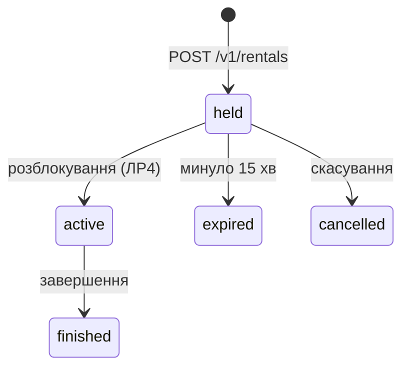
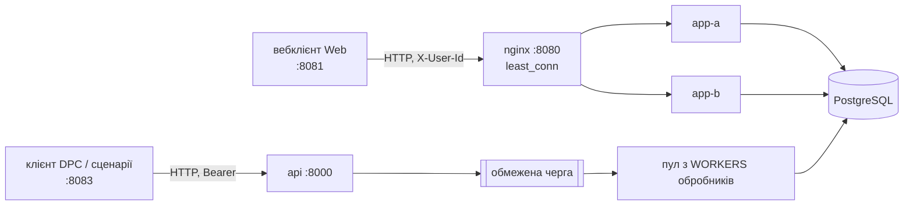

# C08. Каршеринг – спільний проєкт курсів «Обмін даними у Web-застосунках» і «Розподілені та паралельні обчислення»

Опис реалізованого проєкту та його результатів за шаблонами `README-template.md` обох курсів.
Частина Web обслуговує водіїв, частина DPC веде облік оренд зон; спільні PostgreSQL і предметна модель.

## 1. Курс і тема

| | |
|---|---|
| Курси | «Обмін даними у Web-застосунках» (Web) · «Розподілені та паралельні обчислення» (DPC) |
| Тема | C08. Каршеринг |
| Автори | Володимир Нагорнюк, Владислав Даценко |
| Стан | виконано ЛР1 обох курсів |

## 2. Проєкт

Водій бронює автомобіль на 15 хвилин, розблоковує його після перевірки посвідчення, їде й завершує
оренду. Головна складність – двоє на один автомобіль біля аеропорту.

**Ролі.** Водій (`user`) бронює й бачить лише свої оренди; оператор (`staff`) переводить авто на обслуговування.

**Головна операція.** Web – `POST /v1/rentals`, бронювання автомобіля (стан `held`). DPC – `POST /v1/rental-starts`,
команда «старт оренди» в обмежену чергу.

**Стани й переходи.** Оренда (Web): `held → active → finished`; `held → expired | cancelled`.
Команда старту (DPC): `queued → processing → done | rejected | failed`.



**Ресурс та інваріанти.**

| # | Інваріант | Частина | Як забезпечено |
|---|---|---|---|
| 1 | Автомобіль не більше ніж в одній незавершеній оренді (`held` або `active`) | Web | `SELECT … FOR UPDATE` рядка `car` у транзакції бронювання + частковий унікальний індекс `rental_one_open_per_car` |
| 2 | Автомобіль на обслуговуванні не бронюється | Web | перевірка `car.status` під тим самим блокуванням |
| 3 | Орендованих авто зони не більше, ніж є (`zone_cars`): `rented` = кількість ефектів ≤ `cars_total` | DPC | `SELECT … FOR UPDATE` рядка `zone_cars`; перевірка, зміна й запис ефекту – одна транзакція |

**Повільний виклик (DPC).** Перевірка посвідчення водія, 300–900 мс; посвідчення водіїв з id на `nolicense` не
підтверджується (навчальне правило).

**Точні величини й час.** Тариф – копійки за хвилину й за кілометр (`integer`), суми – `bigint` копійок + валюта `UAH`.
Моменти – `timestamptz`, у клієнті показуються в зоні `Europe/Kyiv` (назва зони зберігається окремо в `zone.time_zone`).
Заряд – цілі відсотки 0–100. Бронювання – 15 хв (`HOLD_MINUTES`).

**Наступні ЛР за карткою.** Зовнішня система Web (ЛР4) – симулятор «сервіс авто» `POST /unlock`, 2–8 с, 10 % «посвідчення
не підтверджено». Зміна Web (ЛР6) – страхування оренди за окрему плату. Розрахунок DPC (ЛР2) – інтеграл
n(t) = N(1 − e^(−t/τ)) на [0; T] (машино-години), еталон через первісну N(t + τe^(−t/τ)). Ключ ефекту DPC (ЛР3) – `command_id`.
Звіт DPC (ЛР4) – середня тривалість і виручка за зонами й днями тижня. Потік DPC (ЛР5) – топік `telemetry`,
ковзне вікно 15 хв із кроком 1 хв, середнє `power_kw` за `car_id`. Роль DPC (ЛР6) – служба віддаленого блокування авто.

## 3. Архітектура



| Компонент | Технологія | Роль |
|---|---|---|
| `nginx` | nginx 1.31 | балансувальник `least_conn` перед `app-a`, `app-b`; передає `X-Request-ID` |
| `app-a`, `app-b` | Python 3.14, FastAPI, psycopg 3 | сервер Web; стану в процесі немає, усе в базі |
| `api` | Python 3.14, FastAPI, asyncio | сервіс DPC: приймання, черга, пул обробників, ресурс зони |
| `postgres` | PostgreSQL 17 | спільна база обох частин |
| `migrate` | `psql` + SQL-файли | застосовує `migrations/NNN_*.sql` по порядку під час запуску |

**Шлях запиту Web.** Клієнт → nginx → один з екземплярів → транзакція: блокування авто, перевірка інваріантів 1–2,
позначення простроченого `held` як `expired`, вставка `rental` → фіксація → `201` з `Location`.

**Шлях запиту DPC.** `POST` резервує місце в черзі (без `await` між перевіркою й резервуванням) → рядок `rental_start`
у стані `queued` → `202` з `Location`. Обробник бере id з черги → `processing` → повільний виклик поза критичною
секцією й без з'єднання з базою → транзакція над `zone_cars` → `done` або `rejected`. Повна черга – одразу `429`
з `Retry-After: 1`, запит не записується.

**Навчальні припущення.** Демопарк: аеропорт 10 авто, центр 6, Поділ 4 (одне на обслуговуванні). Ресурс DPC
`zone_cars` для цих зон дорівнює парку Web; окремі зони `loadtest` (100 000) і `test-unprotected` (5) – для перевірок DPC.
`QUEUE_CAPACITY=50`, `WORKERS=4`.

### Спільний проєкт

- **Хто змінює стан.** Web змінює лише оренди (`rental`). Лічильник орендованих авто зони (`zone_cars.rented`) і ефекти
  старту змінює тільки DPC. Команду блокування авто після оренди надсилає лише служба DPC (ЛР6 DPC); Web показує водію стан авто.
- **Спільні ідентифікатори й ключі повтору.** `car_id`, `rental_id`; `rental_id` Web – це `command_id` старту оренди в DPC
  і ключ його ефекту.
- **Контракт взаємодії.** Web → DPC: `POST /v1/rental-starts` (`command_id`, `car_id`, `driver_id`, `zone`),
  `Authorization: Bearer`, відповіді `202`/`200`/`409`/`429` – [dpc/openapi.yaml](dpc/openapi.yaml). Web надсилатиме її
  після розблокування (ЛР4 Web).
- **Повтори й недоступність.** Повтор з тим самим `command_id` і тими самими полями повертає поточний стан (`200`) без
  другого запису, з іншими полями – `409`. На `429` або недоступність DPC Web повторюватиме з тим самим `command_id`
  (ЛР4 Web, черга вихідних подій).
- **Наскрізний приклад** з'явиться з ЛР4 Web: бронювання авто у Web → розблокування → старт оренди в DPC → `active` у
  клієнті Web. До того дії іншої частини відтворюють сценарії з `experiments/`.

У розділі 6 результати зіставлено окремо з пунктами Web і DPC.

## 4. Структура репозиторію

| Шлях | Призначення |
|---|---|
| `compose.yaml`, `.env.example` | запуск усієї системи однією командою |
| `migrations/` | спільна схема (`001` – Web, `002` – DPC) і демодані `900_seed.sql` |
| `web/server/app/` | сервер Web; код проєкту – `rentals.py`, `cars.py`, `users.py` ([web/README.md](web/README.md)) |
| `web/openapi.yaml`, `web/client/` | контракт і клієнт Web |
| `dpc/api/app/` | сервіс DPC; код проєкту – `rental_starts.py` ([dpc/README.md](dpc/README.md)) |
| `dpc/openapi.yaml`, `dpc/client/` | контракт і клієнт DPC |
| `experiments/` | сценарії перевірки й дослідів |
| `results/` | збережені результати дослідів |
| `checks.yaml`, `redocly.yaml` | налаштування засобу check і лінтера контрактів |

Каталоги `web/` і `dpc/` починаються з комплектів курсів (MIT); готові модулі каркаса перелічено в їхніх README.

## 5. Збирання й запуск

Потрібні Docker 24+ з Compose v2 (пам'ять для Docker від 2 ГБ для ЛР1), вільні порти 8080, 8001, 8002, 8000, 5432,
для сценаріїв – [uv](https://docs.astral.sh/uv/). Усі команди виконуються з кореня репозиторію.

```sh
docker compose up -d --build        # postgres, migrate (міграції й демодані), app-a, app-b, nginx, api
docker compose ps
curl -i http://localhost:8080/health
curl -i http://localhost:8000/health
```

Міграції й демодані застосовує сервіс `migrate` під час запуску. Параметри й типові значення – у
[.env.example](.env.example) (файл `.env` необов'язковий). `docker compose down -v` видаляє базу; наступний запуск
створить її заново.

Клієнти (поза Compose, кожен в окремому терміналі):

```sh
uv run python -m http.server 8081 --bind 127.0.0.1 --directory web/client   # http://localhost:8081
uv run python -m http.server 8083 --bind 127.0.0.1 --directory dpc/client   # http://localhost:8083
```

Облікові записи з демоданих: Web (до ЛР3 – заголовок `X-User-Id`) – `u-driver-1`, `u-driver-2` (водії), `u-operator`
(оператор); DPC – токен `dev-token`.

## 6. Лабораторні роботи

### Web · ЛР1. Контракт, модель і перша операція

| Пункт | Де реалізовано | Перевірка та свідчення |
|---|---|---|
| О1.1 Ядро. Модель області | розд. 2 цього README | сутності, стани з діаграмою, інваріанти, числові параметри як навчальні припущення |
| О1.2 Ядро. Схема БД | [migrations/001_carsharing_core.sql](migrations/001_carsharing_core.sql) | PK/FK, `NOT NULL`, `CHECK` станів і величин, `UNIQUE` номера, частковий `UNIQUE` для інваріанта 1; гроші – цілі копійки + `currency`; час – `timestamptz` |
| О1.3 Ядро. Контракт API | [web/openapi.yaml](web/openapi.yaml) | OpenAPI 3.1, приклади запитів (`normal`, `scarce`, `missing`, `in-service`) і відповідей, помилки – Problem Details. `npx @redocly/cli@1.34.5 lint web/openapi.yaml` – без помилок і попереджень |
| О1.4 Ядро. Головна операція | [web/server/app/rentals.py](web/server/app/rentals.py) | одна транзакція, `201` + `Location` після фіксації; 400/401/404/409/422; id – рядки. Дослід «Двоє на одне авто» в розділі 7: один `201` і дев'ять `409` |
| О1.6 Система, /health, журнал | `compose.yaml`, [nginx.conf](web/configs/nginx/nginx.conf), каркас `middleware.py` | одна команда запускає nginx, app-a, app-b, postgres; `/health` без бази; кожна відповідь має `X-Request-ID`; рядок журналу JSON: `time`, `instance`, `route` (шаблон), `status`, `duration_ms`. `check_lab1.py`: `/health` через nginx відповідають обидва екземпляри |
| О1.7 Ядро. Клієнт | [web/client/](web/client/index.html) | зона → вільні авто → бронювання → картка результату або Problem Details (`status`, `title`, `detail`, `errors`); невідомі поля відповіді не заважають. Знімок – [results/web-client-lr1.png](results/web-client-lr1.png) |

### Web · ЛР2. Конкуренція та повторення запитів

| Пункт | Де реалізовано | Перевірка та свідчення |
|---|---|---|
| | | |

### Web · ЛР3. Вхід і доступ

| Пункт | Де реалізовано | Перевірка та свідчення |
|---|---|---|
| | | |

### Web · ЛР4. Довгі операції, події й зовнішня система

| Пункт | Де реалізовано | Перевірка та свідчення |
|---|---|---|
| | | |

### Web · ЛР5. Сповіщення через WebSocket

| Пункт | Де реалізовано | Перевірка та свідчення |
|---|---|---|
| | | |

### Web · ЛР6. Зміна системи та поступове оновлення

| Пункт | Де реалізовано | Перевірка та свідчення |
|---|---|---|
| | | |

### DPC · ЛР1. Сервіс із чергою та модель виконання

| Пункт | Де реалізовано | Перевірка та свідчення |
|---|---|---|
| О1.1 Ядро. Приймання запитів | [rental_starts.py](dpc/api/app/rental_starts.py) `accept`, [002_dpc_rental_starts.sql](migrations/002_dpc_rental_starts.sql) | `202` + `Location` до обробки; стани `queued → processing → done/rejected/failed`; `GET /v1/rental-starts/{id}`, `GET /v1/zone-cars/{id}`. `check_lab1.py`: команда доходить до `done`, без посвідчення – `rejected` |
| О1.2 Ядро. Обмежена черга й перевантаження | `asyncio.Queue(maxsize=QUEUE_CAPACITY)` + резервування місця в `accept` | повна черга → `429` з `Retry-After: 1`, запит не записується. Обробник чекає `await queue.get()`: корутина спить на Future черги, не займаючи потік, і її будить `put`. Дослід «Заповнена черга» в розділі 7: p95 `/health` – 26.8 мс |
| О1.3 Ядро. Пул обробників | `_worker` × `WORKERS` | рівно `WORKERS` задач asyncio; повільний виклик `asyncio.sleep` не блокує приймання: у досліді «Заповнена черга» за 30 с сервіс відповів на 13 617 POST |
| О1.4 Ядро. Захист спільного ресурсу | `_apply_locked` / `_apply_unprotected` | дослід «Останні авто зони» в розділі 7: без синхронізації – порушення у 2 з 3 запусків, з блокуванням – 0 з 3 |

### DPC · ЛР2. Паралельний чисельний розрахунок

| Пункт | Де реалізовано | Перевірка та свідчення |
|---|---|---|
| | | |

### DPC · ЛР3. Розподілена обробка в Ray і відновлення

| Пункт | Де реалізовано | Перевірка та свідчення |
|---|---|---|
| | | |

### DPC · ЛР4. Пакетний звіт у Spark

| Пункт | Де реалізовано | Перевірка та свідчення |
|---|---|---|
| | | |

### DPC · ЛР5. Потокова обробка, запізнення й відновлення

| Пункт | Де реалізовано | Перевірка та свідчення |
|---|---|---|
| | | |

### DPC · ЛР6. Координація виконавців

| Пункт | Де реалізовано | Перевірка та свідчення |
|---|---|---|
| | | |

## 7. Досліди

Перевірки виконаних пунктів обох частин – одна команда з кореня: `uv run experiments/check_lab1.py` (24 перевірки).
Порівняльний режим без синхронізації – `RESOURCE_MODE=unprotected`, лише на тестовій зоні `test-unprotected`.

Спільні умови: коміт `1ba1ff4`; Linux, 4 vCPU, 15 ГБ RAM; PostgreSQL 17.11 у Docker, сервіси – той самий код під
uvicorn (Python 3.14); `QUEUE_CAPACITY=50`, `WORKERS=4`, повільний виклик 300–900 мс.

| Дослід | Режим і команда | Що видно / посилання на результат |
|---|---|---|
| Заповнена черга (DPC О1.2, О1.3) | `uv run experiments/dpc_queue_health.py --clients 50 --seconds 30` | черга 50/50, 13 372 відповіді `429`, p95 `/health` – 26.8 мс. [results/dpc-o1.2-health-under-full-queue.json](results/dpc-o1.2-health-under-full-queue.json) |
| Останні авто зони, без синхронізації (DPC О1.4) | `RESOURCE_MODE=unprotected docker compose up -d api`, потім `uv run experiments/dpc_invariant.py --label unprotected` | у 2 з 3 запусків 7 стартів на 5 авто, `invariant_ok=false`. [results/dpc-o1.4-unprotected.json](results/dpc-o1.4-unprotected.json) |
| Останні авто зони, робочий режим (DPC О1.4) | `docker compose up -d api`, потім `uv run experiments/dpc_invariant.py --label locked` | щоразу рівно 5 стартів, `invariant_ok=true`. [results/dpc-o1.4-locked.json](results/dpc-o1.4-locked.json) |
| Двоє на одне авто (Web О1.4) | `uv run experiments/check_lab1.py` | 10 одночасних бронювань одного авто через nginx → один `201`, дев'ять `409` |

**Заповнена черга**

| Поле | Зміст |
|---|---|
| Пункт і твердження | О1.2. Переповнення черги не сповільнює `/health` понад 100 мс, а відхилені запити не приймаються в обробку |
| Версія й умови | спільні умови; зона `loadtest` (100 000 авто), тож ресурсу вистачає для всіх прийнятих команд |
| Відтворення | Команда з таблиці вище. 50 клієнтів 30 с безперервно надсилають команди (після `429` – одразу наступна); окремий клієнт кожні 20 мс викликає `/health` і міряє час HTTP-відповіді на своєму боці; раз на секунду читається `/metrics` |
| Прогноз | Довжина черги не більша за 50. Пропускна здатність ≈ 4 / 0.6 с ≈ 6.7 команди/с, тобто ≈ 200 за 30 с плюс 50 у черзі. p95 `/health` ≤ 100 мс |
| Вимірювання | Після заповнення черга 50 у 28 з 29 щосекундних замірів (раз 49). POST: 245 × `202`, 13 372 × `429`. `/health`, 680 запитів: p50 12.8, p95 26.8, p99 38.3, max 55 мс |
| Свідчення | [results/dpc-o1.2-health-under-full-queue.json](results/dpc-o1.2-health-under-full-queue.json) |
| Висновок | За цього навантаження черга не перевищила місткості, а `/health` уклався в поріг. Це час HTTP-відповіді, а не повний час обробки команди |

**Останні авто зони**

| Поле | Зміст |
|---|---|
| Пункт і твердження | О1.4. Кількість стартів оренди в зоні не перевищує кількості авто |
| Версія й умови | спільні умови; зона `test-unprotected`, `cars_total=5`; перед кожним запуском сценарій скидає `rented=0` і видаляє команди й ефекти зони |
| Відтворення | Команди з таблиці вище: 20 одночасних команд старту в зону, очікування кінцевих станів, читання `/v1/zone-cars/test-unprotected`; 3 запуски на режим |
| Прогноз | `unprotected` – ефектів більше, ніж авто, і `rented` менший за кількість ефектів (втрачене оновлення); `locked` – рівно 5 `done`, 15 `rejected` |
| Вимірювання | `unprotected`: `done` = 5, 7, 7; у 2-му й 3-му запусках `rented=5`, `effects=7`, `invariant_ok=false`. `locked`: усі 3 запуски – 5 `done`, 15 `rejected`, `rented = effects = 5` |
| Свідчення | [results/dpc-o1.4-unprotected.json](results/dpc-o1.4-unprotected.json), [results/dpc-o1.4-locked.json](results/dpc-o1.4-locked.json) |
| Висновок | Без синхронізації обробники, що прочитали те саме `rented`, усі проходять перевірку. З блокуванням рядка перевірка й зміна виконуються послідовно; у 3 запусках порушень не виявлено |

## 8. Межі гарантій і керовані відмови

> Інваріант зони перевірено на одному процесі `api` з 4 обробниками, 20 командами й 3 запусками на режим. Блокування
> рядка в PostgreSQL розраховане й на кілька процесів (задачі Ray у ЛР3 DPC), але цим дослідом це не підтверджено.
> Процес `api` не перезапускався: черга живе в пам'яті, тож після аварії незавершені команди отримують `failed`,
> а не обробляються повторно (О1.1 цього не вимагає). Час `/health` виміряно на тій самій машині, без мережевих
> затримок між вузлами.

> Гонку бронювання Web перевірено 10 одночасними запитами через два екземпляри; повтор після втраченої відповіді
> (ідемпотентність) – пункт ЛР2 Web і ще не реалізований: зараз повтор отримує `409`.

Керованих відмов (`FAULTS`) у ЛР1 не відтворювали.

## 9. Внесок учасників

Роботу розподілено порівну: кожен виконав частину обох курсів.

| Учасник | Реалізовані пункти й виконані досліди |
|---|---|
| Володимир Нагорнюк | Web О1.2, О1.3, О1.4 – схема БД, контракт, транзакція бронювання; DPC О1.2, О1.3 – обмежена черга, пул обробників; дослід «Заповнена черга» |
| Владислав Даценко | Web О1.1, О1.6, О1.7 – модель області, nginx і журнал, вебклієнт; DPC О1.1, О1.4 – приймання команд, захист ресурсу зони; дослід «Останні авто зони» |

### Використані бібліотеки

Точні версії залежностей зафіксовані у файлах `web/server/uv.lock` і `dpc/api/uv.lock`.

| Бібліотека | Для чого використана | Місце застосування |
|---|---|---|
| FastAPI, Pydantic | HTTP-маршрути й перевірка тіл запитів | `web/server/app/rentals.py`, `cars.py`; `dpc/api/app/rental_starts.py` |
| psycopg 3 (+ pool) | з'єднання з PostgreSQL, транзакції, `FOR UPDATE` | ті самі файли. Правила бронювання й старту реалізовані кодом проєкту |
| `asyncio` зі стандартної бібліотеки Python | обмежена черга й очікування обробників | `dpc/api/app/rental_starts.py` |
| httpx | сценарії перевірки й дослідів | `experiments/` |
