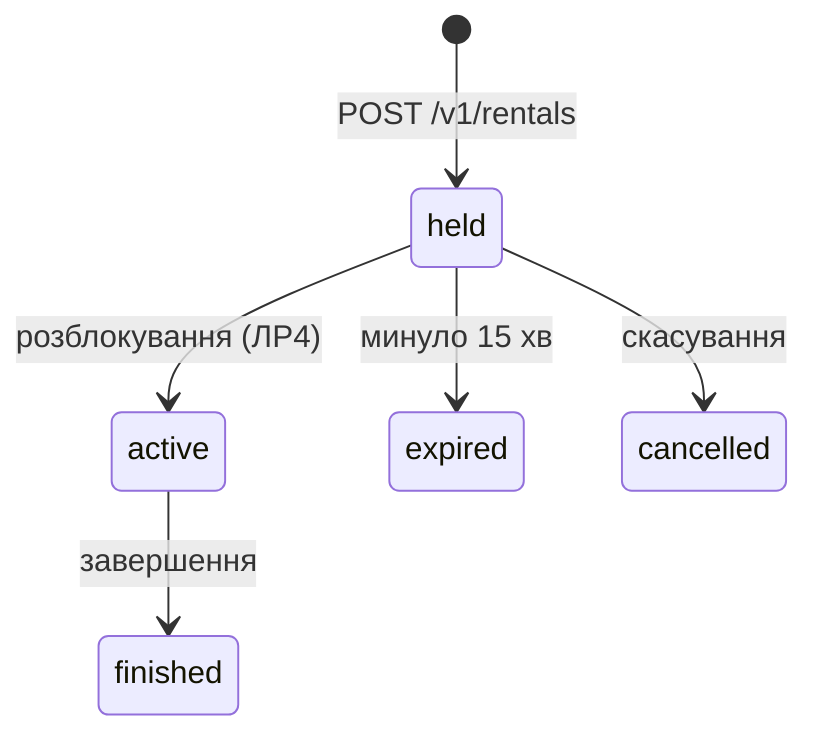
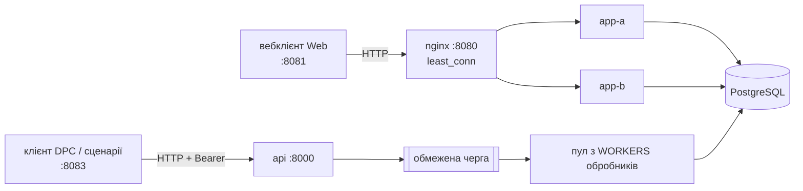

# C08. Каршеринг

Спільний проєкт двох курсів (розд. 1.9 Web і 1.10 DPC): спільні PostgreSQL і предметна модель,
частина Web обслуговує водіїв, частина DPC веде облік оренд зон і аналітику.

## 1. Курс і тема

| | |
|---|---|
| Курси | «Обмін даними у Web-застосунках» (Web) · «Розподілені та паралельні обчислення» (DPC) |
| Тема | C08. Каршеринг |
| Команда | Володимир Нагорнюк, Владислав Даценко |
| Стан | виконано ЛР1 обох курсів |

## 2. Проєкт

Водій бронює автомобіль на 15 хвилин, розблоковує його після перевірки посвідчення, їде й
завершує оренду. Головна складність – двоє на один автомобіль біля аеропорту.

- **Ролі.** Водій (`user`) бронює й бачить лише свої оренди; оператор (`staff`) переводить авто на обслуговування (ЛР3).
- **Головна операція Web.** `POST /v1/rentals` – забронювати автомобіль (стан `held`, строк 15 хв).
- **Головна операція DPC.** `POST /v1/rental-starts` – команда «старт оренди» в обмежену чергу; обробник
  перевіряє посвідчення водія (повільний виклик 300–900 мс) і збільшує лічильник орендованих авто зони.

**Інваріанти**

| # | Інваріант | Хто тримає | Як |
|---|---|---|---|
| 1 | Автомобіль не більше ніж в одній незавершеній оренді (`held` або `active`) | Web | `SELECT … FOR UPDATE` рядка `car` у транзакції бронювання + частковий унікальний індекс `rental_one_open_per_car` |
| 2 | Автомобіль на обслуговуванні не бронюється | Web | перевірка `car.status` під тим самим блокуванням |
| 3 | Орендованих авто зони не більше, ніж є: `rented = кількість ефектів ≤ cars_total` | DPC | `SELECT … FOR UPDATE` рядка `zone_cars`; перевірка, зміна й запис ефекту – одна транзакція |

**Стани оренди (Web)**



**Стани команди старту (DPC):** `queued → processing → done | rejected | failed`;
`rejected` – немає вільних авто в зоні або посвідчення не підтверджено, `failed` – помилка обробки.

**Числові параметри (навчальні припущення).** Бронювання – 15 хв (`HOLD_MINUTES`). Тариф – копійки
за хвилину й за кілометр (`integer`), суми – `bigint` копійок + валюта `UAH`. Моменти – `timestamptz`,
показуються в зоні `Europe/Kyiv` (назва зони зберігається окремо в `zone.time_zone`). Заряд – цілі відсотки
0–100. Демопарк: аеропорт 10 авто, центр 6, Поділ 4 (одне на обслуговуванні).
Повільний виклик DPC – 300–900 мс; `QUEUE_CAPACITY=50`, `WORKERS=4`.

## 3. Архітектура



| Компонент | Технологія | Роль |
|---|---|---|
| `nginx` | nginx 1.31 | балансувальник `least_conn` перед `app-a`, `app-b`; передає `X-Request-ID` |
| `app-a`, `app-b` | Python 3.14, FastAPI, psycopg 3 | сервер Web; стану в процесі немає, усе в базі |
| `api` | Python 3.14, FastAPI, asyncio | сервіс DPC: приймання, черга, пул обробників, ресурс зони |
| `postgres` | PostgreSQL 17 | спільна база обох частин |
| `migrate` | `psql` + SQL-файли | застосовує `migrations/NNN_*.sql` по порядку при старті |

**Шлях головної операції Web.** Клієнт → nginx → один з екземплярів → транзакція: блокування авто,
перевірка інваріантів 1–2, позначення простроченого `held` як `expired`, вставка `rental` → фіксація → `201` з `Location`.

**Шлях команди DPC.** `POST` резервує місце в черзі (без `await` між перевіркою й резервуванням) → рядок
`rental_start` у стані `queued` → `202` з `Location`. Обробник бере id з черги → `processing` → повільний виклик
поза критичною секцією й без з'єднання з базою → транзакція над `zone_cars` → `done` або `rejected`.
Повна черга – одразу `429` з `Retry-After: 1`, запит не записується.

### Спільний проєкт

За розділом 6 картки DPC:

- Спільні ідентифікатори: `car_id`, `rental_id`. `rental_id` частини Web – це `command_id` старту оренди в DPC.
- Web бронює конкретне авто й змінює лише таблицю `rental`; лічильник орендованих авто зони (`zone_cars.rented`)
  змінює тільки DPC. Команду блокування авто після оренди надсилає лише служба DPC (ЛР6 DPC); Web показує стан.
- Передача команди старту з Web у DPC з'явиться з розблокуванням (ЛР4 Web): після підтвердження посвідчення
  Web надсилає `POST /v1/rental-starts` з `command_id = rental_id`. Повторна передача з тим самим `command_id`
  не створює другого ефекту (вже зараз: той самий `command_id` → поточний стан, `200`).
- До того дії іншої частини відтворюють сценарії з `experiments/`.

## 4. Структура репозиторію

| Шлях | Призначення |
|---|---|
| `compose.yaml`, `.env.example` | запуск усієї системи однією командою |
| `migrations/` | спільна схема (`001` – Web, `002` – DPC) і демодані `900_seed.sql` |
| `web/server/app/` | сервер Web; наш код – `rentals.py`, `cars.py`, `users.py` ([web/README.md](web/README.md)) |
| `web/openapi.yaml`, `web/client/` | контракт і клієнт Web |
| `dpc/api/app/` | сервіс DPC; наш код – `rental_starts.py` ([dpc/README.md](dpc/README.md)) |
| `dpc/openapi.yaml`, `dpc/client/` | контракт і клієнт DPC |
| `experiments/` | сценарії перевірки й дослідів |
| `results/` | збережені результати дослідів |
| `checks.yaml`, `redocly.yaml` | налаштування засобу check і лінтера контрактів |

Каталоги `web/` і `dpc/` починаються з комплектів курсів (MIT); готові модулі каркаса перелічено в їхніх README.

## 5. Збирання й запуск

Потрібні Docker 24+ з Compose v2 (пам'ять для Docker від 2 ГБ для ЛР1), вільні порти 8080, 8001, 8002, 8000, 5432.
Для сценаріїв – [uv](https://docs.astral.sh/uv/). Усі команди – з кореня репозиторію.

```sh
docker compose up -d --build        # postgres, migrate (міграції й демодані), app-a, app-b, nginx, api
docker compose ps
curl -i http://localhost:8080/health
curl -i http://localhost:8000/health
```

Параметри й типові значення – у [.env.example](.env.example) (файл `.env` необов'язковий).
`docker compose down -v` видаляє базу; наступний запуск створить її заново.

Клієнти (поза Compose, в окремих терміналах):

```sh
python -m http.server 8081 --bind 127.0.0.1 --directory web/client   # http://localhost:8081
python -m http.server 8083 --bind 127.0.0.1 --directory dpc/client   # http://localhost:8083, токен dev-token
```

Демокористувачі Web (до ЛР3 – заголовок `X-User-Id`): `u-driver-1`, `u-driver-2` (водії), `u-operator` (оператор).
Токен DPC – `dev-token`.

**Перевірка ЛР1 однією командою:** `uv run experiments/check_lab1.py` – 24 перевірки обох частин.

## 6. Лабораторні роботи

### Web · ЛР1. Контракт, модель і перша операція

| Пункт | Де реалізовано | Перевірка та результат |
|---|---|---|
| О1.1 Ядро. Модель області | розд. 2 цього README | сутності, стани з діаграмою, інваріанти, числові припущення |
| О1.2 Ядро. Схема БД | [migrations/001_carsharing_core.sql](migrations/001_carsharing_core.sql) | PK/FK, `NOT NULL`, `CHECK` станів і величин, `UNIQUE` номера, частковий `UNIQUE` для інваріанта 1; гроші – `integer`/`bigint` копійок + `currency`; час – `timestamptz` |
| О1.3 Ядро. Контракт API | [web/openapi.yaml](web/openapi.yaml) | OpenAPI 3.1, приклади запитів (`normal`, `scarce`, `missing`, `in-service`) і відповідей, помилки – Problem Details. `npx @redocly/cli@1.34.5 lint web/openapi.yaml` – без помилок і попереджень |
| О1.4 Ядро. Головна операція | [web/server/app/rentals.py](web/server/app/rentals.py) | одна транзакція, 201 + `Location` після фіксації; 400/401/404/409/422; id – рядки. `check_lab1.py`: 12 перевірок PASS, зокрема 10 одночасних бронювань одного авто через обидва екземпляри → один 201 і дев'ять 409 |
| О1.6 Система, /health, журнал | `compose.yaml`, [nginx.conf](web/configs/nginx/nginx.conf), каркас `middleware.py` | одна команда запускає nginx, app-a, app-b, postgres; `/health` без бази; кожна відповідь має `X-Request-ID`; рядок журналу JSON: `time`, `instance`, `route` (шаблон), `status`, `duration_ms`. Перевірка: відповіді `/health` через nginx приходять від обох екземплярів |
| О1.7 Ядро. Клієнт | [web/client/](web/client/index.html) | зона → вільні авто → «Забронювати» → картка результату або Problem Details (`status`, `title`, `detail`, поля `errors`). Читає лише потрібні поля, тож нове поле відповіді не заважає. Знімок – [results/web-client-lr1.png](results/web-client-lr1.png) |

### DPC · ЛР1. Сервіс із чергою та модель виконання

| Пункт | Де реалізовано | Перевірка та результат |
|---|---|---|
| О1.1 Ядро. Приймання запитів | [rental_starts.py](dpc/api/app/rental_starts.py) `accept`, [002_dpc_rental_starts.sql](migrations/002_dpc_rental_starts.sql) | `202` + `Location` до обробки; стани `queued → processing → done/rejected/failed`; `GET /v1/rental-starts/{id}`, `GET /v1/zone-cars/{id}`. Незавершені після аварії процесу запити при старті позначаються `failed` (черга в пам'яті) |
| О1.2 Ядро. Обмежена черга | `asyncio.Queue(maxsize=QUEUE_CAPACITY)` + резервування місця | повна черга → `429`, `Retry-After: 1`. Примітив: обробник чекає `await queue.get()` – корутина спить на Future черги, не займаючи потік, і її будить `put`. Дослід «/health за повної черги» – розд. 7: p95 = 26.8 мс ≤ 100 мс |
| О1.3 Ядро. Пул обробників | `_worker` × `WORKERS` | рівно `WORKERS` задач asyncio; повільний виклик `asyncio.sleep` не блокує приймання (у досліді О1.2 за 30 с сервіс відповів на 13 617 POST і 680 `/health`, поки обробники були зайняті) |
| О1.4 Ядро. Захист ресурсу | `_apply_locked` / `_apply_unprotected` | дослід «Останні авто зони» – розд. 7: без синхронізації 2 з 3 запусків порушили інваріант (7 ефектів на 5 авто), з блокуванням 3 з 3 – рівно 5 |

## 7. Досліди

Умови вимірювань: Linux, 4 vCPU, 15 ГБ; PostgreSQL 17.11 у Docker; `api` – той самий код під uvicorn
(Python 3.14) поза контейнером; `QUEUE_CAPACITY=50`, `WORKERS=4`, повільний виклик 300–900 мс.

| Дослід | Режим і команда | Що видно |
|---|---|---|
| DPC О1.2. `/health` за повної черги | `uv run experiments/dpc_queue_health.py --clients 50 --seconds 30` | після заповнення черга 50/50 у 28 з 29 щосекундних замірів (раз 49); `/health` p50 12.8, **p95 26.8**, p99 38.3, max 55 мс (680 запитів); 245 команд прийнято (202), 13 372 відхилено (429). [JSON](results/dpc-o1.2-health-under-full-queue.json) |
| DPC О1.4. Без синхронізації | `RESOURCE_MODE=unprotected docker compose up -d api`, потім `uv run experiments/dpc_invariant.py --label unprotected` | зона `test-unprotected`, 5 авто, 20 одночасних команд, 3 повтори: done = 5, 7, 7; `rented=5`, `effects=7`, `invariant_ok=false` у двох запусках. [JSON](results/dpc-o1.4-unprotected.json) |
| DPC О1.4. Робочий режим | `docker compose up -d api`, потім `uv run experiments/dpc_invariant.py --label locked` | ті самі дані: щоразу done = 5, rejected = 15, `rented = effects = 5`, `invariant_ok=true`. [JSON](results/dpc-o1.4-locked.json) |
| Web О1.4. Двоє на одне авто | `uv run experiments/check_lab1.py` | 10 одночасних бронювань одного авто через nginx → 1 × 201, 9 × 409 |

**Чому без синхронізації порушується інваріант.** Обробник читає `rented`, після паузи `UNPROTECTED_GAP_MS`
записує `rented + 1` і ефект. Кілька обробників, що прочитали те саме значення, всі проходять перевірку
`rented < cars_total`: ефектів стає більше, ніж авто, а лічильник через втрачене оновлення менший за кількість
ефектів. Перший запуск без порушення: обробники випадково не перетнулись між читанням і записом.

## 8. Межі гарантій

- Інваріант 3 перевірено на одному екземплярі `api` з 4 обробниками; блокування рядка в PostgreSQL розраховане й
  на кілька процесів (задачі Ray у ЛР3), але це ще не перевірялось.
- Черга DPC живе в пам'яті процесу: після аварії прийняті, але не оброблені команди отримують `failed`, а не
  обробляються повторно (О1.1 цього не вимагає). Коректне завершення з повною чергою (Д1.4) не реалізоване.
- Тривалість `/health` міряно на стороні клієнта на тій самій машині; мережевих затримок між вузлами дослід не охоплює.
- Повтор бронювання Web після втраченої відповіді (ідемпотентність) – ЛР2; зараз повтор створює `409`.
- Керованих відмов (`FAULTS`) у ЛР1 не відтворювали.

## 9. Внесок учасників

Роботу розподілено порівну: кожен виконав частину обох курсів.

| Учасник | Пункти |
|---|---|
| Володимир Нагорнюк | Web О1.2, О1.3, О1.4; DPC О1.2, О1.3; дослід «/health за повної черги» |
| Владислав Даценко | Web О1.1, О1.6, О1.7; DPC О1.1, О1.4; дослід «Останні авто зони» |
| Разом | спільна модель і межа частин, `compose.yaml`, README |

### Використані бібліотеки

| Бібліотека | Для чого | Де |
|---|---|---|
| FastAPI, Pydantic | маршрути, перевірка тіл запитів | `web/server/app/`, `dpc/api/app/` |
| psycopg 3 (+ pool) | PostgreSQL, транзакції, `FOR UPDATE` | `rentals.py`, `cars.py`, `rental_starts.py` |
| httpx | сценарії перевірки й дослідів | `experiments/` |
